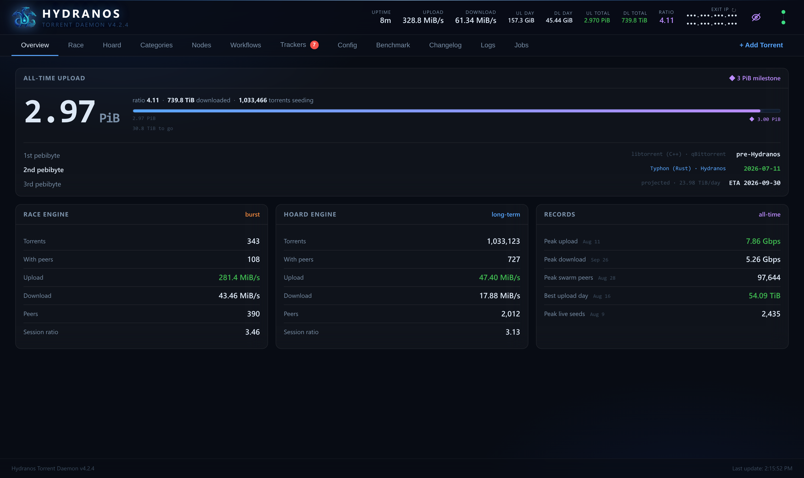
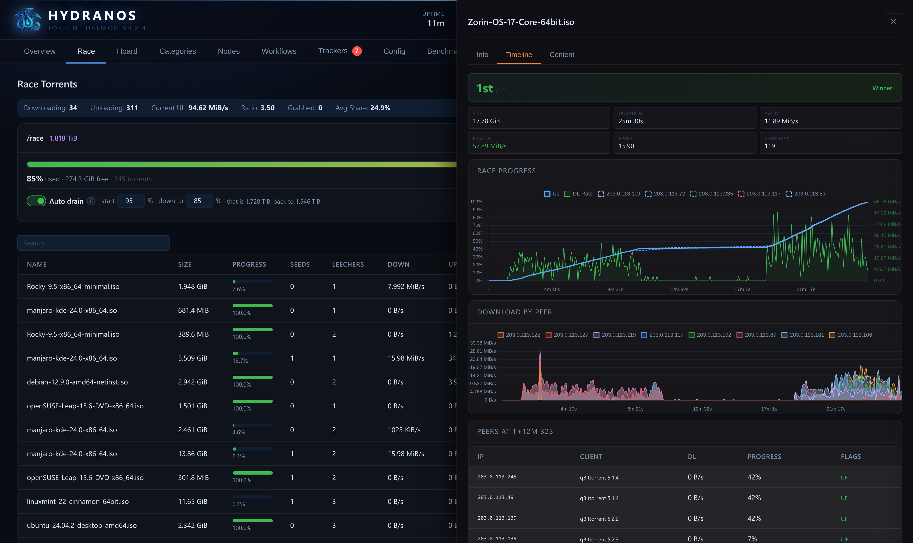
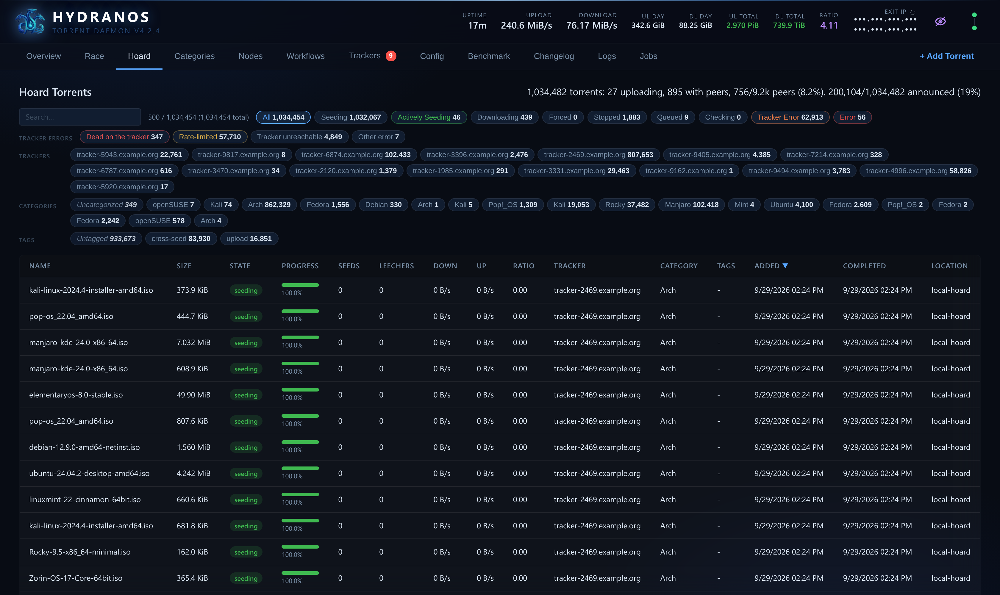
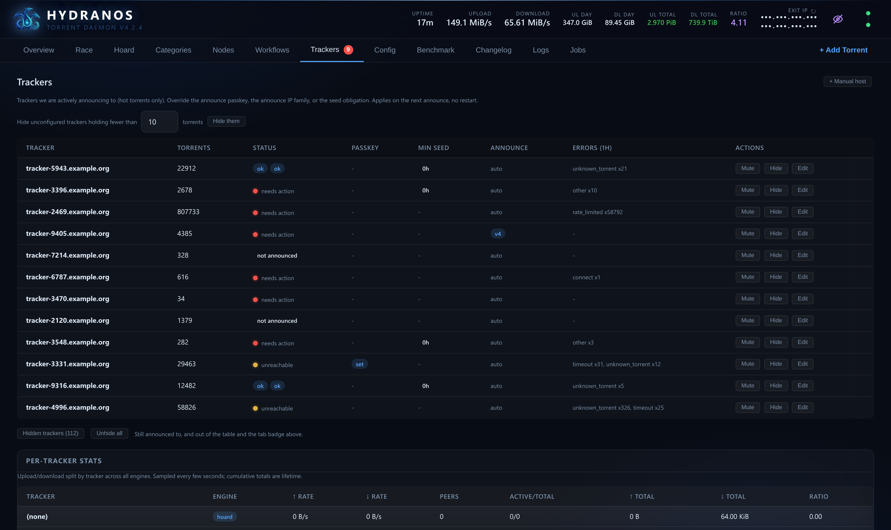
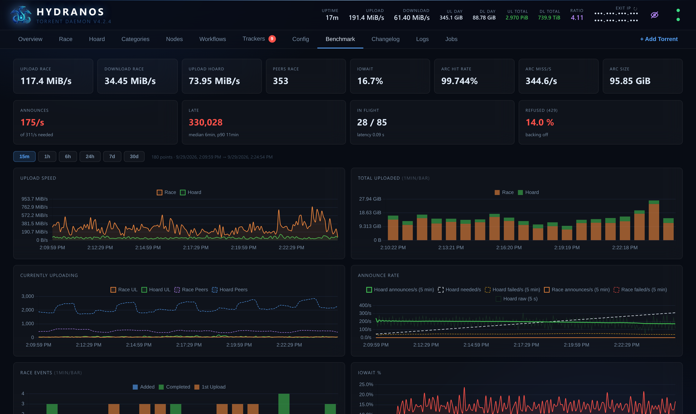
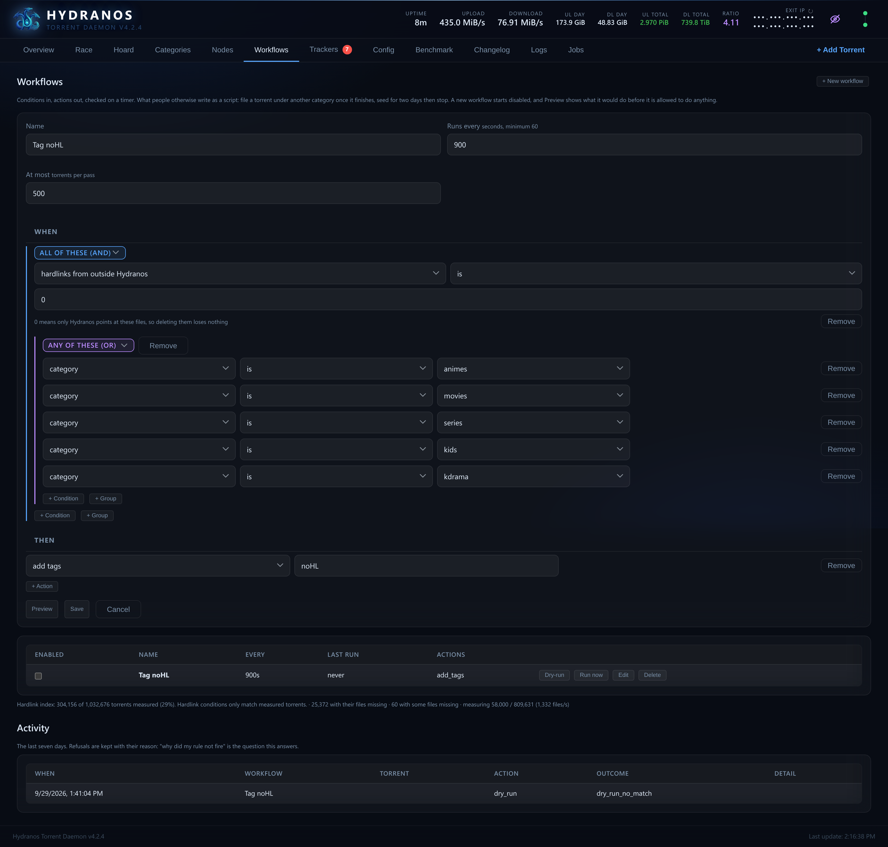

# Hydranos

**Seed over a million torrents from one box.** Hydranos is a self-hosted BitTorrent client built for that scale on a single machine, with a live web UI, a native REST API and a qBittorrent-compatible API, so your `*arr` / autobrr / cross-seed setup keeps working unchanged.

Same machine, ~290,000 torrents, four clients ([method and caveats](docs/scale-290k.md): single runs, read them as orders of magnitude; Hydranos measured on 4.2):

| | Hydranos 4.2 | Transmission 4.1.3 | qBittorrent 5.2.3 | rtorrent 0.16.24 |
|---|---|---|---|---|
| Cold start to API | 95-125 s | 48 min | 91 min | 15 h 21 min |
| RAM after load | 2.8 GiB | 12.3 GiB | 15.6-18.3 GiB | 31.3 GiB |
| Announces/s | 146-155 | 13.6 default, 61 raised | ~15 default, 86 raised | ~4-12 |

<!-- GIF: scrolling the 100k-row list -->

## Quick start

```sh
docker run -d --name hydranos --restart unless-stopped --stop-timeout 150 \
  --ulimit nofile=1048576:1048576 \
  -p 8199:8199 -p 16171:16171/tcp -p 16171:16171/udp -p 16172:16172/tcp -p 16172:16172/udp \
  -v "$PWD/config:/config" -v "$PWD/data:/data" \
  ghcr.io/kheopsian/hydranos:latest
docker logs hydranos | grep 'setup code'
```

Pin a release tag (`:v4.7.0`) instead if you want to choose when you upgrade, and back up `./config` before each upgrade (see [Upgrading and rolling back](#upgrading-and-rolling-back)).

- UI and API: <http://localhost:8199>. Open it, enter the one-time **setup code** from the log and create the admin account (the first-run screen only answers callers on this machine or a private network).
- Config, resume data and the SQLite store: `./config` (mounted at `/config`, seeded on first start). Payload data: `./data`. BitTorrent ports 16171 (race) and 16172 (hoard) are published too.
- Scripts talk to the API with the key kept in `config/default.toml`, sent as `X-Api-Key` ([`docs/API.md`](docs/API.md)).
- Bare metal: unpack the Linux tarball (amd64 or arm64) from the [releases](https://github.com/Kheopsian/Hydranos/releases) and run `sudo ./install.sh` (systemd, see [`packaging/install.sh`](packaging/install.sh)). Windows: the zip from the same page, see [`packaging/README-windows.md`](packaging/README-windows.md).
- Full walkthrough: [Installation & First Run](https://github.com/Kheopsian/Hydranos/wiki/Installation-and-First-Run).

## What sets it apart

- **Two engines, two jobs.** **Race** is for releases you race: torrents in a race-mode category (the default) live there for a while — aggressive (it re-announces every 5 s while the tracker has not registered the upload yet), with a detailed per-torrent timeline and metrics — and are usually removed once your tracker's rules allow it; the few you want to keep can **graduate** to hoard. **Hoard** is the long-term library engine, built to stay light at a million torrents (no piece-hash tables kept for seeds, about 10 KiB per torrent); categories in hoard mode (cross-seeds, long-term imports) send torrents straight there. Each engine has its own port and its own rules ([`docs/API.md`](docs/API.md)).
- **Light at scale.** 2.8 GiB of RAM for ~293,000 torrents (about 10 KiB each) and a cold start of 95-125 s, in the table above ([`docs/scale-290k.md`](docs/scale-290k.md)).
- **Your automation keeps working.** A qBittorrent v2 API shim (`/api/v2/*`) for Sonarr/Radarr, autobrr and cross-seed, and an importer for an existing qBittorrent library ([`docs/API.md`](docs/API.md)).
- **Tracker conformance, documented and tested.** Every rule names the test that asserts it, and `tools/interop/run.sh` plays the client against opentracker, Torrust and qBittorrent/libtorrent in CI ([`docs/BITTORRENT-CONFORMANCE.md`](docs/BITTORRENT-CONFORMANCE.md)).
- **Workflows.** Rules built from conditions and actions over the library, previewed with a dry run before they run ([`docs/API.md`](docs/API.md)).

## Upgrading and rolling back

`:latest` follows each release. To upgrade only when you decide, pin a release tag (`ghcr.io/kheopsian/hydranos:v4.7.0`) and change it on purpose; with `:latest`, an image auto-updater upgrades you as soon as a release is out. Read the [`CHANGELOG.md`](CHANGELOG.md) first: a *major* number change means the upgrade needs more than replacing the binary.

**Back up before you upgrade:** stop the container (`docker stop hydranos`, or `docker compose stop`; it flushes the resume data) and copy the whole `config/` folder (bare metal: `/etc/hydranos` and `/var/lib/hydranos`; Windows: the folder holding `hydranos.exe`). It holds `default.toml` (API key, password hash), `hydra.db` and `bench.db`. There is no automatic backup yet. To go back, stop, restore that copy and start the previous tag. Only the latest release gets fixes, and only the 10 most recent releases keep their images and archives ([`SECURITY.md`](SECURITY.md)); older ones are built from the tag. No downgrade procedure is documented: treat the backup as the way back.

---

## Also in the box

- **Networking per engine**: managed WireGuard (a tunnel per engine, with
  port forwarding), gluetun, SOCKS5 or a PROXY-v2 relay, an interface pin,
  and a kill switch that keeps an engine off the network when its way out
  is down.
- **qBittorrent's day-to-day features**: the download queue (including
  "do not count slow torrents"), share limits, speed limits, RSS feeds with
  automatic download rules, file priorities, sequential download, magnets,
  UDP trackers and LSD.
- **Several machines behind one UI**: engines on other machines enrol as
  nodes, and torrents move between them.
- **Existing data**: an add hash-checks what is already on disk instead of
  downloading over it, and a qBittorrent library can be imported as is.
- **Observability**: Prometheus `/metrics`, a benchmark tab with a line
  speedtest and before/after comparison, and an MCP server for AI assistants.
- **Linux (Docker or bare metal) and Windows.**

---

## For tracker operators

What Hydranos puts on the wire is documented, rule by rule, in
**[`docs/BITTORRENT-CONFORMANCE.md`](docs/BITTORRENT-CONFORMANCE.md)**. Every
claim there names the test that asserts it: the unit suite runs offline in
seconds, and `tools/interop/run.sh` runs the client against opentracker,
Torrust in private mode and qBittorrent/libtorrent, reading the verdict from
their state rather than ours. Both run on every push. In short:

- **Session counters.** `uploaded`/`downloaded` count from `started`, never
  the lifetime total; `left` comes from the pieces held.
- **BEP 3 events per tracker.** `started`, `completed` (once, to every tracker
  that saw us leech, retried if one is down) and `stopped`; a cross-seed is
  never a snatch.
- **Your floors hold.** `min interval`, BEP 31 `retry in` and `Retry-After` are
  obeyed per tracker, races included. Only a re-announce a person forces
  crosses `min interval`, as qBittorrent's does. An unregistered race is
  retried every 5 s for 6 minutes (`registration_retry_minutes`), the
  window autobrr uses. BEP 12 tier order is
  respected, and `tracker id` is echoed back.
- **One identity.** Peer id `-HY####-`, the same to every tracker and every
  peer, `User-Agent: Hydranos/<version>`, a stable secret `key`. No client
  spoofing.
- **Private torrents stay private** (BEP 27): no DHT, PEX, hole punching or
  LSD, and peers named by other peers are ignored.
- **Scrape only for what is not announced yet.** Swarm counts come from the
  announce response; a torrent no tracker has answered for (queued at boot,
  stopped) is scraped (BEP 48 / BEP 15) for its counts and nothing else.

---

## Screenshots

All screenshots below are taken with **incognito mode on**: torrent names,
categories, paths, IPs and tracker hostnames are replaced by stable fakes.

**Overview** — live dashboard: global up/down, seeding/leeching counts,
per-session throughput.



**Race** — one finished race in detail: where it placed in the swarm, how
the download went, which peers it came from, and what it has uploaded since.



**Hoard** — the long-term seeding library, filtered by tracker, state and
category.



**Trackers** — one row per tracker actually announced to: passkey override,
announce IP family, seed obligation, and the errors seen in the last hour.



**Benchmark** — traffic per engine, disk and cache health, and whether the
announces keep up with the catalogue, from fifteen minutes to thirty days;
plus a line speedtest and a before/after comparison around a change.



**Workflows** — rules over the library, built from conditions and actions and
previewed before they run. Here: tag every torrent in the media categories whose
files have no hardlink outside Hydranos, i.e. that can be deleted without
losing anything.



---

## Documentation

Install steps, architecture, every networking mode and the edge cases live in
the **[Wiki](https://github.com/Kheopsian/Hydranos/wiki)**:

- [Installation & First Run](https://github.com/Kheopsian/Hydranos/wiki/Installation-and-First-Run)
- [Migrating from qBittorrent](https://github.com/Kheopsian/Hydranos/wiki/Migrating-from-qBittorrent)
- [Architecture](https://github.com/Kheopsian/Hydranos/wiki/Architecture)
- [Networking Modes](https://github.com/Kheopsian/Hydranos/wiki/Networking-Modes)
- [Deployment Topologies](https://github.com/Kheopsian/Hydranos/wiki/Deployment-Topologies)
- [Categories & Routing](https://github.com/Kheopsian/Hydranos/wiki/Categories-and-Routing)
- [Adding Torrents & Existing Data](https://github.com/Kheopsian/Hydranos/wiki/Adding-Torrents-and-Existing-Data)
- [qBittorrent Shim & Automation](https://github.com/Kheopsian/Hydranos/wiki/qBittorrent-Shim-and-Automation)
- [Queue, Share and Speed Limits](https://github.com/Kheopsian/Hydranos/wiki/Queue-Share-and-Speed-Limits)
- [RSS & Automatic Downloads](https://github.com/Kheopsian/Hydranos/wiki/RSS-and-Automatic-Downloads)
- [VPN & Egress](https://github.com/Kheopsian/Hydranos/wiki/VPN-and-Egress) · [Managed WireGuard](https://github.com/Kheopsian/Hydranos/wiki/Managed-WireGuard)
- [Prometheus Metrics](https://github.com/Kheopsian/Hydranos/wiki/Prometheus-Metrics)
- [Configuration Reference](https://github.com/Kheopsian/Hydranos/wiki/Configuration-Reference)
- [Troubleshooting](https://github.com/Kheopsian/Hydranos/wiki/Troubleshooting) · [Known Limitations](https://github.com/Kheopsian/Hydranos/wiki/Known-Limitations)

API reference: [`docs/API.md`](docs/API.md). Companion VPS relay:
[hydra-relay](https://github.com/Kheopsian/hydra-relay).

---

## License

Hydranos is licensed under the **GNU Affero General Public License v3.0** (AGPL-3.0).
See [`LICENSE`](LICENSE). In short: you're free to run, study, modify, and
share it, including self-hosting a modified version, but if you offer a modified
Hydranos to others over a network, you must make your source available under the
same license.
